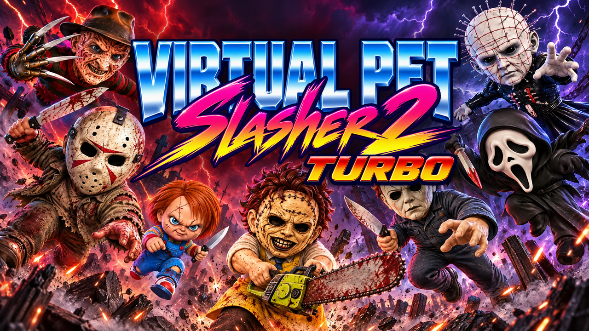
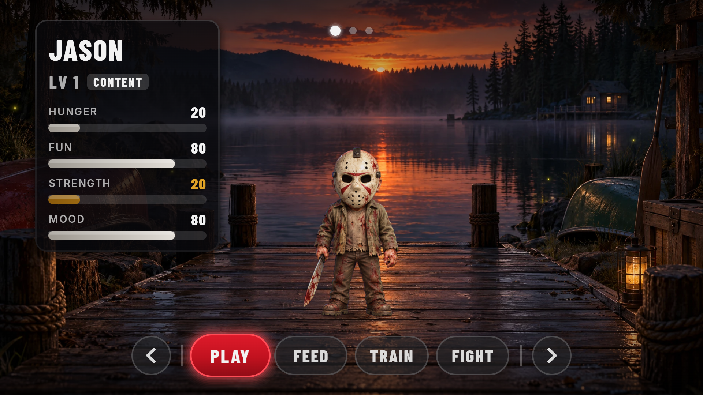
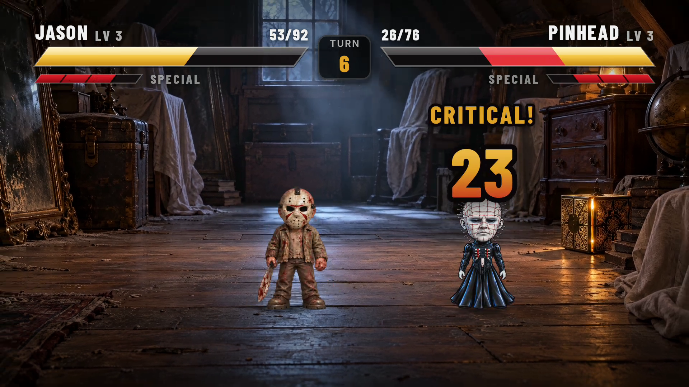

<p align="center">
  
</p>

# Virtual Pet Slasher 2 Turbo

Virtual pets from your favorite horror films, right on your TV. It is a Tamagotchi for the living room:
you start with one chibi slasher icon, feed it, play with it, train it and make it fight, and every killer you
beat joins your stable, until all seven live on your Android TV. Everything runs offline, with a D-pad remote and
nothing else.

<p align="center">
  
  
</p>

## Features

- **Seven killers:** Jason, Freddy, Pinhead, Ghostface, Chucky, Michael and Leatherface, each with its own stats, three scenes from its movie, music, a fight passive and a signature special. The newest, Leatherface, revs his Chainsaw passive (his heavy hits land 20% harder) and, for his special, the Saw Dance: he does his chainsaw dance while blades and sparks whirl around his opponent. Hit Play on Home and he dances for you too.
- **Press start, pick one:** every launch opens on the title screen. A new game starts with one killer of your
  choice from a spotlight carousel; the rest are locked. The little CREDITS link in its corner (Down on a remote)
  names the artists whose chibi figures the killers are loosely based on.
- **Unlock your stable:** beat a locked killer in a fight and it is UNLOCKED, joining your stable. Once you have
  more than one, the others take turns in the top-right corner of Home, their heads ringed by Fed, Fun, Strength
  and Mood; open the stable there (or with the remote's Menu key) to go see any of them.
- **Real-time care:** Hunger, Fun, Strength and Mood keep moving while you are away. Play, feed and train to keep them happy.
- **Playtime:** your big cartoon glove comes in to tickle, poke, dangle keys over or pick up and shake your killer, with baby talk to match.
- **Feeding time:** a snack whistles down from the sky (meat on the bone, a turkey leg, canned spinach, a cake with a knife in it, popcorn or a jello brain) and gets munched, bite by bite.
- **Training games:** TRAIN spins a film reel, slot-machine style, onto one of four quick games, each played until
  your first mistake: Slasher Says, Quick Draw, Hide and Eek! and Organ Drop. The better the score, the harder your
  killer trains (up to triple the strength and XP), and it keeps its best in each. Quick Draw and Hide and Eek! need a
  stable mate, so they only come up once you have a second killer. A new killer trains at both solo games (Slasher
  Says and Organ Drop) before its first fight, or FIGHT says "Train more first!".
- **Fake death:** leave a pet alone for a week and you get a tombstone and "R.I.P.". Then: "GOTCHA. NEVER DIES."
- **VS fights:** turn-based, Street-Fighter-style bouts picked from an RPG command window, with crits, blocks and specials, called by a shouting arena announcer who reacts to the big moments. Damage pops up in red (−23); two potions a fight are tossed onto your killer for half to all of its health back, in green (+34). Win XP, level up.
- **Made for TVs:** 16:9 and 4:3, remote-only controls, Android 5.1 and up (Google TV, Onn, Fire TV, Android TV).
- **Plays on phones too:** the same APK, in landscape, with touch. Tap the buttons and the stable badge, swipe
  left or right to walk between scenes, tap or swipe through the pet lineup (tap the pet in the spotlight to
  pick it), tap to skip the VS card. The back gesture works like the remote's Back.
  ([On a phone](docs/touch/phone-home.jpg).)

## Install

Download `horror-pets-<version>.apk` from [Releases](https://github.com/superfunteam/horror-pets/releases/latest), then sideload it:

- **adb:** turn on developer options and network debugging on the TV, then
  `adb connect <tv-ip>:5555 && adb install horror-pets-<version>.apk`.
- **Downloader app** (Google TV, Onn, Fire TV): install Downloader (by AFTVnews, free in the app stores), allow it to install unknown apps,
  and enter the release asset URL, for example
  `https://github.com/superfunteam/horror-pets/releases/download/v0.1.0/horror-pets-0.1.0.apk`.

On a phone, open the release asset URL in the browser and install the downloaded APK (Android asks you to
allow installing apps from the browser the first time).

Later versions install over the top and keep your pets, because every release is signed with the same key.

**Updates come to you:** you only sideload once. On launch the game checks GitHub for a newer release and, if there
is one, offers it on the title screen: UPDATE downloads it right in the game (with a progress bar) and hands it to
Android's installer. The first time on Android 8 and up, Android asks you to allow installs from the game; allow it in the
settings screen the game opens, then come back. LATER (or Back) skips it until the next launch.

## Develop

You need **JDK 17** (Temurin is fine; the build does not download one for you) and the Android SDK
(`ANDROID_HOME`, or `sdk.dir` in `local.properties`).

```sh
./gradlew assembleDebug testDebugUnitTest lintDebug
adb -s <device> install -r app/build/outputs/apk/debug/app-debug.apk
```

**Time travel (debug builds only).** Shift the game clock forward to watch decay and the fake death without waiting:

```sh
adb shell am force-stop team.superfun.horrorpets && \
adb shell am start -n team.superfun.horrorpets/.MainActivity --ef advance_hours 200
```

When you are done time travelling, wipe the app's data. The offset clock saved a "last seen" time in the
future, and with the real clock behind it no time passes, so the pets stop decaying until the real clock
catches up:

```sh
adb shell pm clear team.superfun.horrorpets
```

### Puppet mode (debug builds)

Drive the game from adb, for recording footage without playing by hand. It lives in `app/src/debug/` only: a
release build has no puppet code and ignores all of this. Send a line of commands, separated by `;`, as the `cmd`
extra of a broadcast while the game runs, or of a cold start (run after the save loads). Quote the whole adb command
so the device's shell keeps the `;`:

```sh
adb -s emulator-5554 shell "am start -S -n team.superfun.horrorpets/.MainActivity --es cmd 'pet freddy; fight pinhead'"
adb -s emulator-5554 shell "am broadcast -a team.superfun.horrorpets.PUPPET --es cmd 'meter full; move special'"
adb -s emulator-5554 shell "am broadcast -a team.superfun.horrorpets.PUPPET --es cmd 'autoplay on; wait home; fight jason'"
adb -s emulator-5554 logcat -s Puppet    # every command, what came of it, and each screen as it comes up
adb -s emulator-5554 shell "am start -S -n team.superfun.horrorpets/.MainActivity --es cmd 'fake_version 0.5.0; check_update'"
adb -s emulator-5554 logcat -s Puppet Updates    # the update check, download and install
```

| Command | What it does |
| --- | --- |
| `unlock_all` | Every killer joins the stable. |
| `pet <killer>` | That killer (`jason`, `freddy`, `pinhead`, `ghostface`, `chucky`, `michael`, `leatherface`) becomes the active pet, joining the stable if needed, and Home comes up. |
| `level <n>` | The active pet's level (1 to 99); Home then offers its new attacks on the learn screens. `--ei debug_level <n>` on a cold start still does the same. |
| `learn_all` | The active pet learns what its level unlocks and equips the best attack in each slot, with no learn screens. |
| `fight <killer>` | Straight into a CPU fight against that killer, through the VS card. It skips the "Train more first!" check, so it works on a fresh save. |
| `autoplay on\|off` | Fights (CPU and PvP) pick the player's moves: 0.8 s after the menu is up, SPECIAL when the meter is full, POTION under 30% HP, else the answer to the CPU's tell (BLOCK a STRIKE, STRIKE a HEAVY, HEAVY a BLOCK), else STRIKE and HEAVY in turn. Results, unlock and learn cards, and the pantry's reaction after a meal, continue after 2.5 s (a learn screen learns). |
| `hud off\|on` | Fights (CPU and PvP) hide their HUD for clean footage: the bars, meters, turn badge and status chips, the command and help windows, and PvP's waiting banner. The fighters, callouts, damage numbers, the CPU's tell, cut-ins, the VS card, K.O. and the cards after still show. The hidden menu still takes `move` and autoplay picks. On by default; it lasts until changed, across fights. |
| `move <strike\|heavy\|block\|special\|potion\|run>` | Picks that move now, if the fight allows it. A `run` runs without asking. |
| `meter full` | Fills the player's special meter (CPU fights only: a PvP fight must play the same on both apps). |
| `feed`, `play`, `train` | That care action, going Home first. `feed` opens the pantry (its shelf topped up as for a player) and eats nothing until `serve`. `train` opens the training reel, which picks a game and then plays it. Nothing is paid until a game ends. |
| `train <game>` | Training on that game (`slash_says`, `quick_draw`, `hide_and_seek`, `organ_drop`) instead of the pick. Quick Draw and Hide and Eek! need another killer in the stable (`unlock_all`), else the command is refused. |
| `score <n>` | Ends the training game on screen now with that score (0 or more): the pet is paid for it and the results card comes up, as if the game had ended with it. |
| `stock <id> [<id>…]` | Adds those items to the end of the pantry's shelf, on any screen (`grill`, `raw_steak`, `steak_dinner`: an item's id is its name in lower case with underscores). Stops when the shelf is full (40 items); an id the game does not know is refused. |
| `cook <id> <id>` | In the pantry, cooks those two items from the shelf, which must hold both (two of the same id take two places). Like a player's COOK: both are used up, the result takes the earlier place, and it is saved. A botched dish on the board is refused and stays on the board. |
| `serve <id>` | In the pantry, feeds that item from the shelf to the active pet, like a player's FEED; a pet too full to eat refuses it. The reaction card then waits for OK (or autoplay's 2.5 s). |
| `home` | Back to Home from anywhere but a fight (a learn screen is put off until the next launch; a training game or the pantry is left, or its card dismissed). |
| `wait <seconds>`, `wait home` | Holds the rest of the line: for that long, or until Home is up and idle (a fight and its cards over). |
| `status` | Logs the screen, the active pet and whether autoplay and the HUD are on. |
| `fake_version <x.y.z>\|off` | The update check takes this build to be that version (a dev build, `0.0.0-dev`, never updates otherwise); `off` goes back to the real one. It lasts until changed or the app is stopped. Send `check_update` after it. |
| `check_update` | Checks GitHub for a newer release now, even after LATER, and offers it in the update window. The window only shows over the title, so send it from a cold start. The outcome is logged under `Updates`. A debug build cannot install a release over itself (they are signed with different keys): the installer refuses, and the window says so. |

Each command waits for the action playing (a turn, a feed) to end first. A command that is refused (logged as
`refused:` with the reason) drops the rest of its line, and a new line replaces one still waiting. Moves are picked
through the fight menu, so the cursor goes to each before it is taken. These change the save like play does, so
use an emulator whose save you do not mind changing.

### Regenerating assets

The finished art and audio are committed (`sprites-final/`, `scenes-final/`, `audio-final/`) and Gradle bundles them into the APK.
The generators live in `tools/` and need Python 3, `ffmpeg` (with libopus) and `cwebp`:

```sh
python3 -m venv tools/.venv && tools/.venv/bin/pip install -r tools/requirements.txt
tools/.venv/bin/python -I -m pytest tools/tests -q
tools/.venv/bin/python -I tools/synth_audio.py                          # original music and sfx, no key needed
ELEVENLABS_API_KEY=... tools/.venv/bin/python -I tools/generate_announcer.py   # announcer lines
OPENAI_API_KEY=... tools/.venv/bin/python -I tools/generate_scenes.py --n 2
OPENAI_API_KEY=... tools/.venv/bin/python -I tools/generate_food.py --n 2   # then pick in finalize_food.py
tools/.venv/bin/python -I tools/finalize_food.py
OPENAI_API_KEY=... tools/.venv/bin/python -I tools/generate_hand.py --n 2  # the Play glove; then finalize_hand.py
OPENAI_API_KEY=... tools/.venv/bin/python -I tools/generate_potion.py --n 3  # the fight's potion; then --pick K
ELEVENLABS_API_KEY=... tools/.venv/bin/python -I tools/generate_player_voice.py
```

The keys are read from the `OPENAI_API_KEY` (scenes, cover) and `ELEVENLABS_API_KEY` (announcer) environment variables only. Never write them to a file or commit them.

## Releasing

Releases are built and signed on the maintainer's machine, and the signing key never leaves it.
CI (`.github/workflows/ci.yml`) builds, tests and lints every PR; pushing a `v*` tag runs `release.yml`,
an unsigned verification build with no secrets.

One-time key setup (the key lives in `~/.horror-pets/`; `tools/release.sh --help` has the exact commands):

1. Generate `release.jks` with `keytool` and put its passwords in `release.properties` next to it (`storePassword`, `keyAlias`, `keyPassword`). Both files `chmod 600`, the folder `700`.
2. **Back up `~/.horror-pets/`.** Android only accepts updates signed with the same key, so if you lose it, installed copies can never be updated.

Then, from a clean `main` that equals `origin/main` (push it first), with the [GitHub CLI](https://cli.github.com/) installed and logged in (`gh auth login`) and push access to the repo:

```sh
tools/release.sh 0.2.0 --dry-run   # build, sign, verify, write dist/horror-pets-0.2.0.apk; publishes nothing
tools/release.sh 0.2.0             # the same, then tag v0.2.0, push it, and create the GitHub Release
```

Before building, the script checks the version, a clean tree, `main` equal to `origin/main`, a free tag, and that `gh` and push access work,
so a missing login stops the release before anything is tagged. It then runs the release tests and lint, verifies the signature
(v1 and v2, and the certificate matches your keystore) and `versionName`/`versionCode` (`versionCode = major*10000 + minor*100 + patch`),
and only then tags that exact commit, pushes the tag and publishes. If the push or the release step fails, it prints the commands to finish by hand.

## Credits and licenses

- Fonts: Barlow Condensed and Inter, under the SIL Open Font License 1.1 (text in `app/src/main/assets/licenses/OFL.txt`).
- Audio: music and sound effects are original and synthesized; the announcer is generated text-to-speech. Details in [`audio-final/CREDITS.md`](audio-final/CREDITS.md).
- Virtual Pet Slasher 2 Turbo is a fan project. Jason (*Friday the 13th*), Freddy (*A Nightmare on Elm Street*), Pinhead (*Hellraiser*), Ghostface (*Scream*), Chucky (*Child's Play*), Michael (*Halloween*) and Leatherface (*The Texas Chain Saw Massacre*), and the films they come from, belong to their respective rights holders. It is not affiliated with or endorsed by any of them, and it is not for sale.
